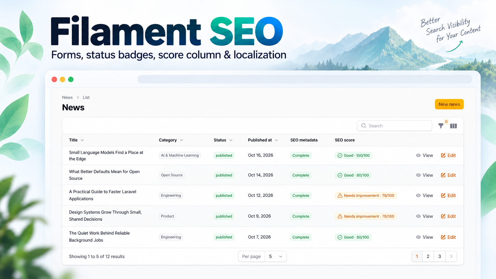

# Filament SEO

Reusable SEO metadata forms, editorial status, metadata quality scoring, and infolist components for Laravel and Filament.



[](https://packagist.org/packages/digit7s/filament-seo)
[](https://packagist.org/packages/digit7s/filament-seo)
[](https://packagist.org/packages/digit7s/filament-seo)
[](https://github.com/Digit7s/filament-seo/actions/workflows/tests.yml)
[](LICENSE)

## Introduction

Filament SEO provides a reusable polymorphic metadata model, an explicitly placed Blade head component, and native Filament components for managing and reviewing metadata alongside application content. It leaves page layout, authorization, and storage policy with the host application.

## Features

- Relationship-bound SEO fields, with grouped sections or optional tabs.
- Configurable owner and site fallbacks with safe canonical and image URL resolution.
- Completeness status and translated issue tooltips.
- A metadata quality score with native Filament badge, color, icon, and findings tooltip.
- Infolist section for stored and optionally resolved metadata.
- English, Myanmar, and Thai package UI translations.

The score is an editorial metadata quality indicator. It does not measure search rankings, traffic, or crawl results.

## Requirements

- PHP `^8.4`
- Laravel `^13.0`
- Filament `^5.0`

The package declares Filament 5.0 as its minimum; local integration has been exercised with newer Filament 5 releases.

## Installation

```bash
composer require digit7s/filament-seo:^0.1
```

Laravel discovers `Digit7s\FilamentSeo\FilamentSeoServiceProvider` through Composer. No Filament panel plugin registration is required or provided.

Publish configuration only when you need to customize the metadata model, fallbacks, defaults, or image settings:

```bash
php artisan vendor:publish --tag=filament-seo-config
```

For a new application without a compatible `seo_metadata` table, publish and review the package migration before running your normal migration command:

```bash
php artisan vendor:publish --tag=filament-seo-migrations
php artisan migrate
```

Do not publish or run the package migration if your application already owns a compatible `seo_metadata` table. The package does not run migrations automatically.

## Model integration

Add `HasSeoMetadata` to an Eloquent model. It defines a `MorphOne` relationship named `seoMetadata()` using the configured metadata model:

```php
use Digit7s\FilamentSeo\Concerns\HasSeoMetadata;
use Illuminate\Database\Eloquent\Model;

class Article extends Model
{
    use HasSeoMetadata;
}
```

Create or update metadata through the relationship:

```php
$article->seoMetadata()->updateOrCreate([], [
    'meta_title' => 'A title for search results',
    'meta_description' => 'A concise description of this article.',
    'robots_index' => true,
    'robots_follow' => true,
]);
```

The package does not create metadata when the relationship is read. The default table uses a polymorphic `seoable` relationship; it does not duplicate metadata columns on the owner table.

## SEO form

Add `SeoFields` to a Filament resource schema. By default it returns a relationship-bound `Section` containing the Basic SEO, Social Metadata, and Robots Directives groups:

```php
use Digit7s\FilamentSeo\Filament\Forms\SeoFields;
use Filament\Schemas\Schema;

public static function form(Schema $schema): Schema
{
    return $schema->components([
        SeoFields::make(relationship: 'seoMetadata'),
    ]);
}
```

To present the same groups in native Filament schema tabs, opt in with `tabbed: true`:

```php
SeoFields::make(
    relationship: 'seoMetadata',
    groups: ['basic', 'social', 'robots'],
    tabbed: true,
)
```

Basic SEO is the first tab by default. The factory also accepts options for selected groups and fields, custom labels, defaults, required/visible/disabled state, image upload settings, length guidance, and collapsibility. Consumer-provided labels and recommendation text remain under the consumer's control.

## SEO status column

Use `SeoStatusColumn` to show completeness and optional translated issue details. Eager-load the relationship in the resource query; the column intentionally does not lazy-load it:

```php
use Digit7s\FilamentSeo\Filament\Tables\SeoStatusColumn;
use Filament\Tables\Table;
use Illuminate\Database\Eloquent\Builder;

public static function getEloquentQuery(): Builder
{
    return parent::getEloquentQuery()->with('seoMetadata');
}

public static function table(Table $table): Table
{
    return $table->columns([
        SeoStatusColumn::make(
            relationship: 'seoMetadata',
            issuesTooltip: true,
            showCompleteness: true,
        ),
    ]);
}
```

Statuses are `complete`, `needs_attention`, `no_stored_metadata`, and `not_loaded`. Intentional `noindex` and `nofollow` directives do not create completeness issues.

## SEO score column

`SeoScoreColumn` returns a native Filament `TextColumn`. It uses the package resolver and scoring rules, and renders its native badge styling and findings tooltip:

```php
use Digit7s\FilamentSeo\Filament\Tables\SeoScoreColumn;
use Filament\Tables\Table;

public static function table(Table $table): Table
{
    return $table->columns([
        SeoScoreColumn::make(),
    ]);
}
```

The calculated score is not persisted and is not database-sortable or searchable. The column shares the eager-loaded relationship shown above. A custom relationship can be passed as `SeoScoreColumn::make(relationship: 'searchMetadata')`.

## SEO infolist

Use `SeoMetadataInfolistSection` on a record view. Eager-load the metadata relation in the page's record query so the section can show stored and resolved values without issuing queries from entries:

```php
use Digit7s\FilamentSeo\Filament\Infolists\SeoMetadataInfolistSection;
use Filament\Schemas\Schema;

public static function infolist(Schema $schema): Schema
{
    return $schema->components([
        SeoMetadataInfolistSection::make(
            relationship: 'seoMetadata',
            groups: ['basic', 'social', 'robots'],
            showResolvedValues: true,
            showCompleteness: true,
        ),
    ]);
}
```

The section distinguishes an unloaded relation, a missing metadata row, and an empty stored value. Image previews are optional and use only URLs accepted by the package resolver.

## Frontend metadata rendering

Place the package component explicitly inside the document `<head>` of a Blade layout. The package does not inject tags into every response or register frontend middleware:

```blade
<head>
    <meta charset="utf-8">
    <meta name="viewport" content="width=device-width, initial-scale=1">
    <x-filament-seo::meta :record="$article" />
</head>
```

The component resolves the configured SEO relationship for that record and renders only meaningful values. It loads the relation when needed; page queries can eager-load it with `with('seoMetadata')`. Consumer fallback values are optional and are applied after stored metadata and package-configured fallbacks:

```php
$seoFallbacks = [
    'title' => fn (Article $record): string => $record->title,
    'description' => fn (Article $record): ?string => $record->excerpt,
];
```

```blade
<x-filament-seo::meta :record="$article" :fallbacks="$seoFallbacks" />
```

The output can contain `<title>`, description and keywords, an HTTPS canonical URL, robots directives, Open Graph title/description/URL/image/alt, and Twitter card/title/description/image/alt. The renderer does not invent an Open Graph type or Twitter account handle. It escapes values, omits invalid canonical URLs, and never renders robots defaults without a stored metadata row. An intentional stored `noindex` or `nofollow` remains intact.

Keep the host layout's metadata ownership clear: do not render duplicate title, description, canonical, robots, Open Graph, or Twitter tags from another head manager. If Laravel Head or an Inertia head component is present, choose one renderer for the tags managed by this component. This package does not provide a dedicated Laravel Head or Inertia adapter.

### Image URL policy

Absolute image URLs must use HTTPS by default; HTTP can be allowed through `filament-seo.images.allow_http`. Relative image paths are emitted only when the configured disk is explicitly listed in `filament-seo.images.public_disks`, and the file exists on that disk. Private disks and missing files are omitted. Direct remote URLs and a configured `images.url_resolver` are trusted host inputs after scheme validation; the package does not make network requests to verify remote reachability. The host remains responsible for public access and external URL availability.

## UI localization

Package UI labels and messages are available in English (`en`), Myanmar (`my`), and Thai (`th`). Laravel's active application locale selects the translation; set it using your normal application or request locale handling. The package does not add a locale switcher.

Publish translations to customize the package's default wording:

```bash
php artisan vendor:publish --tag=filament-seo-translations
```

Published files are placed under `lang/vendor/filament-seo`. Laravel's normal fallback locale applies when a translation is unavailable. To contribute a language, copy the full key structure from `resources/lang/en/filament-seo.php` to `resources/lang/{locale}/filament-seo.php`, translate the UI copy, and preserve key parity.

Localization applies to package UI only. It does not translate or localize stored SEO metadata, create locale-specific rows, or change canonical and hreflang behavior.

## Screenshots

The following captures come from the consumer News demo and show the actual package components:


No infolist or translated-locale capture is included yet. The promotional thumbnail above is a composed product graphic; these screenshots are the feature evidence.

## Testing and development

```bash
composer install
composer test
composer lint
composer validate --strict
```

The package test suite uses Orchestra Testbench and an in-memory SQLite database. It does not use a consumer application's database.

## Limitations and responsibilities

- This package renders supported HTML metadata through an explicit Blade component; it does not generate JSON-LD or sitemaps, crawl websites, or report search rankings.
- It does not automatically translate article content or SEO metadata, or implement multilingual canonical/hreflang strategies.
- The host application owns authorization, public page rendering, locale routing, storage access policy, and orphaned upload cleanup.
- Relationship-backed table and infolist components expect the configured metadata relationship to be eager-loaded.
- The frontend component is Blade-only; no Inertia adapter, frontend route, or automatic tag injection is provided.
- The package migration is optional and should not be run against an application that already has a compatible table.

## Changelog

See [CHANGELOG.md](CHANGELOG.md).

## Security

Please follow the private reporting instructions in [SECURITY.md](SECURITY.md). Do not report vulnerabilities in a public issue.

## Contributing

Contributions should include focused tests for behavior changes and preserve compatibility with the declared PHP, Laravel, and Filament requirements. Before opening a change, run `composer test`, `composer lint`, and `composer validate --strict`.

## License

This package is open-sourced under the [MIT License](LICENSE).

## Credits

Maintained by [Digit7s](https://github.com/Digit7s).
