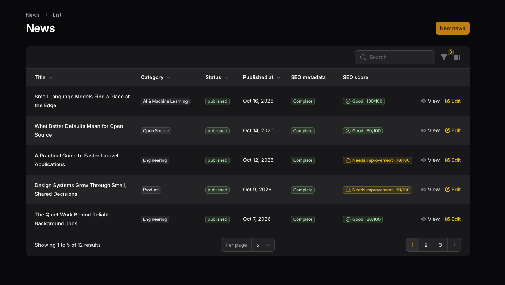
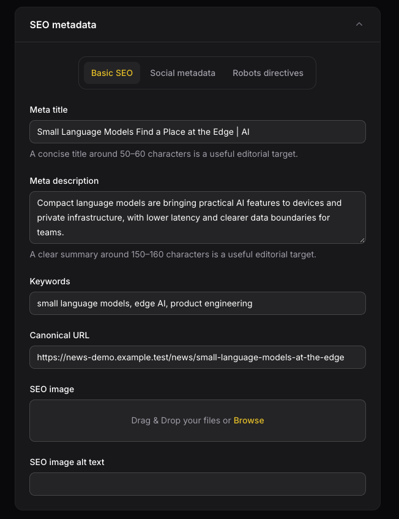

# Filament SEO

SEO metadata, Static Pages, structured data, and sitemap tools for Laravel and Filament.


[](https://packagist.org/packages/digit7s/filament-seo)
[](https://packagist.org/packages/digit7s/filament-seo)
[](https://packagist.org/packages/digit7s/filament-seo)
[](https://github.com/Digit7s/filament-seo/actions/workflows/tests.yml)
[](LICENSE)

## Introduction

Filament SEO provides a reusable polymorphic metadata model, an explicitly placed Blade head component, and native Filament components for managing and reviewing metadata alongside application content. It leaves page layout, authorization, and storage policy with the host application.

## Features

- Relationship-bound SEO fields, with grouped sections or optional tabs.
- Configurable owner and site fallbacks with safe canonical and image URL resolution.
- Completeness status and translated issue tooltips.
- A metadata quality score with native Filament badge, color, icon, and findings tooltip.
- Infolist section for stored and optionally resolved metadata.
- Optional Static Pages registry and Filament resource for model-less frontend routes.
- Explicit, opt-in Schema.org JSON-LD generation for model and Static Page metadata.
- Opt-in XML sitemaps for registered Static Pages and explicitly configured Eloquent models.
- English, Myanmar, and Thai package UI translations.

The score is an editorial metadata quality indicator. It does not measure search rankings, traffic, or crawl results.

## Requirements

- PHP `^8.4`
- Laravel `^13.0`
- Filament `^5.0`
- PHP `ext-xmlwriter`

The package declares Filament 5.0 as its minimum; local integration has been exercised with newer Filament 5 releases.

## Installation

```bash
composer require digit7s/filament-seo:^0.2
```

Laravel discovers `Digit7s\FilamentSeo\FilamentSeoServiceProvider` through Composer. No Filament panel plugin registration is required or provided.

Publish configuration only when you need to customize the metadata model, fallbacks, defaults, or image settings:

```bash
php artisan vendor:publish --tag=filament-seo-config
```

For a new application without a compatible `seo_metadata` table, publish and review the package migration before running your normal migration command:

```bash
php artisan vendor:publish --tag=filament-seo-migrations
php artisan migrate
```

The publish tag includes the existing `seo_metadata` migration, the additive `seo_pages` registry migration, and the additive Structured Data columns migration. If your application already has a compatible `seo_metadata` table, do not publish or run the existing table-creation migration again. Publish only `2026_10_19_000000_create_seo_pages_table.php` and `2026_10_19_100000_add_structured_data_to_seo_metadata_table.php` from the package or copy them into your application's migrations. Review migrations and run them through your normal deployment process. The package does not run migrations automatically.

## Static Page SEO Management

Static Pages stores page identity and SEO metadata. It does not store page content, generate Laravel routes, or create views. The application remains responsible for those frontend routes and views. Metadata is rendered only where you explicitly add the package component.

### Migration

Run the package migrations using the existing install instructions. The new registry has a unique stable `page_key`, an optional unique named `route_name`, a unique normalized `path`, and an active flag. Existing SEO data remains in the same polymorphic `seo_metadata` table and is not migrated or rewritten. Deleting a registry entry also deletes its related metadata row.

### Register the Filament resource

The resource is opt-in. Register it on the panel where authorized staff manage SEO; it is not automatically discovered or added to consumer navigation:

```php
use Digit7s\FilamentSeo\Filament\Resources\SeoPageResource;
use Filament\Panel;

public function panel(Panel $panel): Panel
{
    return $panel
        ->resources([
            SeoPageResource::class,
        ]);
}
```

Keep this resource inside an authenticated Filament panel. The resource denies guests and also denies authenticated users unless the host application defines a Laravel `SeoPagePolicy` or explicit Gate abilities. The supported abilities are `viewAny`, `create`, `view`, `update`, `delete`, and `deleteAny`; every operation is checked by Filament on the server. For example, register a `SeoPagePolicy` with Laravel's policy discovery or `Gate::policy(SeoPage::class, SeoPagePolicy::class)`. Filament Shield is not required; it can provide these policy abilities through its normal Laravel integration.

### Static Page Navigation Customization

Static Pages uses these navigation defaults as soon as the package config is merged; publishing the config is optional:

| Setting | Default |
|---|---|
| Group | `SEO` |
| Label | `Static Pages` |
| Icon | `heroicon-o-globe-alt` |
| Sort | `100` |
| Enabled | `true` |

To customize them, publish the package config and edit the `static_pages.navigation` values in `config/filament-seo.php`:

```bash
php artisan vendor:publish --tag=filament-seo-config
```

```php
'static_pages' => [
    'resolve_current_request' => false,

    'navigation' => [
        'group' => 'Content Management', // Use null to show the item without a group.
        'label' => 'SEO Pages',
        'icon' => 'heroicon-o-document-text',
        'sort' => 30,
        'enabled' => true,
    ],
],
```

The label and group are passed through Laravel's `__()` helper, so configured translation keys can use the application's translation files. The icon accepts a Filament icon name. Sort accepts an integer; use `null` to leave ordering to Filament.

Set `enabled` to `false` to hide Static Pages from panel navigation while keeping its resource routes registered. Authorized users can still reach those routes directly. Setting `enabled` to `true` only allows Filament to consider adding the navigation item; it does not grant permission. Guests and authenticated users without the required `SeoPage` policy or Gate abilities remain denied by the resource's server-side authorization checks.

Navigation configuration is package-wide and applies to panels where the consumer explicitly registers `SeoPageResource`. The package does not automatically register the resource in every panel, and hiding its navigation does not disable routes or change permissions.

### Register pages

In **SEO → Static Pages**, add a name, stable key, optional named Laravel route, and exact path. The key must be lowercase letters/numbers separated by hyphens. Paths are normalized by removing query strings and fragments, converting backslashes to `/`, collapsing repeated `/`, adding one leading slash, and removing trailing `/` (the root is `/`). Paths preserve letter case. Dynamic route patterns and wildcard matching are not supported. Route names and normalized paths must be unique.

The resource reuses `SeoFields`, the polymorphic metadata row, `SeoStatusColumn`, `SeoScoreColumn`, and the shared metadata resolver and quality analyzers. The score describes metadata completeness and field quality; it is not a Google ranking metric.

### Blade integration

Use the stable page key for explicit matching, including on ordinary `Route::view` pages:

```php
Route::view('/about-us', 'pages.about')->name('about');
```

```blade
<head>
    <x-filament-seo::meta page="about-us" />
</head>
```

You can select a registered page by its named route instead:

```blade
<x-filament-seo::meta route="about" />
```

The component accepts exactly one of `record`, `page`, or `route`. The existing `:record="$article"` API remains unchanged. Explicit page/route selection and current-request lookup select active registry entries only. Missing and inactive entries render no tags and do not receive another page's metadata or site fallback values.

### Optional current request matching

To let a shared Blade layout resolve an exact current route name first and normalized path second, enable this explicitly:

```php
// config/filament-seo.php
'static_pages' => [
    'resolve_current_request' => true,
],
```

Then the layout may render `<x-filament-seo::meta />`. Named-route identity takes precedence. If the current named route is registered but inactive, no path fallback is attempted. If it is not registered, only an exact normalized path can match. Query strings and fragments do not affect matching. No dynamic route pattern is scanned and no page is created during a request. The default is `false`, so applications can keep explicit per-page integration.

The registry is not cached initially: explicit selection uses an indexed identity lookup, and opt-in current-request matching uses exact indexed route/path lookups. Metadata changes and active-state changes therefore take effect on the next render without cache invalidation machinery.

## XML Sitemap Generation

XML sitemap routes are opt-in and disabled by default. The package does not crawl routes, inspect every SEO metadata row, discover Eloquent models, or inject sitemap content into Filament. Static Pages and explicitly configured model sources are the only built-in sources. Sitemap output is separate from the JSON-LD component.

Publish the package config if you want to customize it, then enable the route in `config/filament-seo.php`:

```php
'sitemap' => [
    'enabled' => true,
    'path' => 'sitemap.xml',
    'static_pages' => [
        'enabled' => true,
        // Optional host rule: fn (SeoPage $page): bool => ...
        'filter' => null,
    ],
    'models' => [],
    'sources' => [],
    'chunk_size' => 10000,
    'cache' => [
        'enabled' => false,
        'ttl' => 3600,
        // Optional trusted fn (): string|int|null for tenant/content scope isolation.
        'scope_resolver' => null,
    ],
],
```

When enabled, Laravel registers GET routes for `sitemap.xml` and `sitemap-{chunk}.xml` (for example `sitemap-1.xml`). The base route returns a URL set when there is one document and a sitemap index when it spans multiple documents. Route actions are controller actions compatible with `route:cache`. The package checks existing GET route matches and route names during registration and throws a clear exception on a collision; change `path` to an unused relative `.xml` path. Paths cannot contain traversal, query strings, fragments, or unsafe characters and are limited to 200 characters. Route registration is based on configuration at application boot, so deploy the same cached configuration on every application instance.

Active registered Static Pages are included when their optional host `static_pages.filter` accepts them and their SEO metadata does not set `robots_index` to false. A registered page without an SEO metadata row is considered indexable; this preserves the resolver's default robots behavior and does not create metadata. Static-page public URLs come from the registry path and configured `app.url`, never from request Host headers or the stored admin URL. A non-empty canonical URL takes precedence only when it is valid and on the configured site origin; an invalid or cross-domain canonical excludes the entry. URL fragments are removed, query strings are retained, trailing slashes are normalized, and equivalent URLs are emitted once. `nofollow` alone does not exclude a URL.

Model sources must be explicitly listed. The host application supplies its publication and visibility query because the package cannot infer those rules:

```php
use App\Models\News;
use App\Sitemap\PublishedNewsQuery;
use Illuminate\Database\Eloquent\Builder;

'models' => [
    News::class => [
        'enabled' => true,
        'route' => 'news.show',
        'route_key' => 'slug',
        // Optional when the route placeholder name differs from route_key.
        'route_parameter' => 'news',
        'query' => PublishedNewsQuery::class,
        // Only provide this when it reflects a real content change.
        'lastmod' => 'published_at',
    ],
],
```

Use either `route` plus `route_key`/`route_parameter`, or a trusted `url` callback receiving the model. The URL callback may return an absolute same-origin URL or a relative path. A valid same-origin canonical URL on loaded SEO metadata takes precedence over that URL. Models with the configured SEO relationship are loaded in stable primary-key chunks; UUID/string single-column keys are supported. Composite keys are not supported. A `query` callback receives the Eloquent builder and may add the application's published, tenant, authorization, or other public-content constraints. Keep the primary key selected and avoid grouping or custom ordering; the package reorders by the model key for stable keyset iteration. Eloquent global scopes, including SoftDeletes, continue to apply. Missing metadata means indexable by default, while stored `robots_index = false` excludes the model. The package never treats every `seo_metadata` row as a page.

For `config:cache` compatibility, use an invokable class name or `ClassName@method` string for `query`, `url`, `lastmod`, the Static Page `filter`, and `cache.scope_resolver`; closures are accepted at runtime but cannot be exported by Laravel's config cache. The example's `PublishedNewsQuery` should implement `__invoke(Builder $query)` and return the builder with the host application's full published-content constraints.

Packages and host applications can add a trusted source by listing its class name in `sitemap.sources`. The class must implement `Digit7s\FilamentSeo\Sitemap\SitemapSource` and yield `SitemapEntry` values. The shared generator validates each yielded location against the configured site origin and deduplicates it with the built-in sources.

`lastmod` is omitted unless a model source explicitly names an attribute or supplies a callback returning a date/time value. Static pages do not have a content timestamp and therefore omit it. SEO metadata's `updated_at` is not used as a substitute for content modification time. Date strings must be absolute date or ISO-style date-time values; relative or malformed strings are omitted rather than converted to a timestamp.

The package uses PHP's XMLWriter extension for UTF-8 XML escaping and emits only `loc` and optional W3C-formatted `lastmod`. The protocol allows up to 50,000 URLs and 50 MB uncompressed per document; this implementation uses a conservative 8 MB maximum per generated document to bound PHP worker memory. `chunk_size` defaults to 10,000 and must be from 1 to 50,000. Model records are read in 500-row keyset batches by default (`model_chunk_size`). A fixed 50,000 unique URL safety ceiling bounds exact cross-source deduplication memory in this request-time implementation. Larger sites should use host-owned pre-generation or a sitemap service; multi-file indexes work within the safety ceiling. Empty sources return a valid empty URL set. The sitemap index references the package's actual numbered chunk routes; it does not point at files that the package has not generated.

The initial delivery strategy is on-demand generation with optional Laravel cache storage. Cache is disabled by default; without it, each uncached endpoint request traverses the configured sources. Enable caching for production sites with substantial content and choose a TTL that matches the acceptable freshness window; source changes may remain cached until expiry. The sitemap index and its numbered documents are cached from the same generation snapshot. Invalidate package sitemap entries after relevant content or config changes with `app(\\Digit7s\\FilamentSeo\\Sitemap\\SitemapCache::class)->clear()`. The configured Laravel cache store is used; Redis is not required. Cache keys include the application name, site URL, normalized sitemap configuration, and an optional hashed scope value. If configured sources vary by tenant or another request-scoped identity, configure `cache.scope_resolver` to return that stable tenant/content key; the callback must not return the request Host header. Use an invokable class or `ClassName@method` for config caching. `clear()` affects the current scope. For multi-instance deployments, use a shared cache store if all instances should serve the same cached sitemap.

The host remains responsible for public route existence, publication and authorization constraints, tenant visibility, and meaningful lastmod values. The package does not request URLs, follow redirects, infer private route rules, or guarantee search engine indexing. After deploying the enabled route, submit its public URL in Google Search Console and monitor crawl/indexing reports; a sitemap is a discovery hint, not an indexing guarantee.

### Inertia applications

There is no Inertia adapter. For server-rendered Inertia pages, render the component from the Laravel root Blade view when the request can identify an exact registered route or when the controller supplies page SEO data. For client-only head rendering, expose the resolved values through application-owned page props and let one head manager render them. Avoid rendering both this component and Inertia's `<Head>` for the same tags; this package does not inject metadata into every response.

## Model integration

Add `HasSeoMetadata` to an Eloquent model. It defines a `MorphOne` relationship named `seoMetadata()` using the configured metadata model:

```php
use Digit7s\FilamentSeo\Concerns\HasSeoMetadata;
use Illuminate\Database\Eloquent\Model;

class Article extends Model
{
    use HasSeoMetadata;
}
```

Create or update metadata through the relationship:

```php
$article->seoMetadata()->updateOrCreate([], [
    'meta_title' => 'A title for search results',
    'meta_description' => 'A concise description of this article.',
    'robots_index' => true,
    'robots_follow' => true,
]);
```

The package does not create metadata when the relationship is read. The default table uses a polymorphic `seoable` relationship; it does not duplicate metadata columns on the owner table.

## SEO form

Add `SeoFields` to a Filament resource schema. By default it returns a relationship-bound `Section` containing the Basic SEO, Social Metadata, and Robots Directives groups:

```php
use Digit7s\FilamentSeo\Filament\Forms\SeoFields;
use Filament\Schemas\Schema;

public static function form(Schema $schema): Schema
{
    return $schema->components([
        SeoFields::make(relationship: 'seoMetadata'),
    ]);
}
```

To present the same groups in native Filament schema tabs, opt in with `tabbed: true`:

```php
SeoFields::make(
    relationship: 'seoMetadata',
    groups: ['basic', 'social', 'robots'],
    tabbed: true,
)
```

Basic SEO is the first tab by default. The factory also accepts options for selected groups and fields, custom labels, defaults, required/visible/disabled state, image upload settings, length guidance, and collapsibility. Consumer-provided labels and recommendation text remain under the consumer's control.

## SEO status column

Use `SeoStatusColumn` to show completeness and optional translated issue details. Eager-load the relationship in the resource query; the column intentionally does not lazy-load it:

```php
use Digit7s\FilamentSeo\Filament\Tables\SeoStatusColumn;
use Filament\Tables\Table;
use Illuminate\Database\Eloquent\Builder;

public static function getEloquentQuery(): Builder
{
    return parent::getEloquentQuery()->with('seoMetadata');
}

public static function table(Table $table): Table
{
    return $table->columns([
        SeoStatusColumn::make(
            relationship: 'seoMetadata',
            issuesTooltip: true,
            showCompleteness: true,
        ),
    ]);
}
```

Statuses are `complete`, `needs_attention`, `no_stored_metadata`, and `not_loaded`. Intentional `noindex` and `nofollow` directives do not create completeness issues.

## SEO score column

`SeoScoreColumn` returns a native Filament `TextColumn`. It uses the package resolver and scoring rules, and renders its native badge styling and findings tooltip:

```php
use Digit7s\FilamentSeo\Filament\Tables\SeoScoreColumn;
use Filament\Tables\Table;

public static function table(Table $table): Table
{
    return $table->columns([
        SeoScoreColumn::make(),
    ]);
}
```

The calculated score is not persisted and is not database-sortable or searchable. The column shares the eager-loaded relationship shown above. A custom relationship can be passed as `SeoScoreColumn::make(relationship: 'searchMetadata')`.

## SEO infolist

Use `SeoMetadataInfolistSection` on a record view. Eager-load the metadata relation in the page's record query so the section can show stored and resolved values without issuing queries from entries:

```php
use Digit7s\FilamentSeo\Filament\Infolists\SeoMetadataInfolistSection;
use Filament\Schemas\Schema;

public static function infolist(Schema $schema): Schema
{
    return $schema->components([
        SeoMetadataInfolistSection::make(
            relationship: 'seoMetadata',
            groups: ['basic', 'social', 'robots'],
            showResolvedValues: true,
            showCompleteness: true,
        ),
    ]);
}
```

The section distinguishes an unloaded relation, a missing metadata row, and an empty stored value. Image previews are optional and use only URLs accepted by the package resolver.

## Frontend metadata rendering

Place the package component explicitly inside the document `<head>` of a Blade layout. The package does not inject tags into every response or register frontend middleware:

```blade
<head>
    <meta charset="utf-8">
    <meta name="viewport" content="width=device-width, initial-scale=1">
    <x-filament-seo::meta :record="$article" />
</head>
```

The component resolves the configured SEO relationship for that record and renders only meaningful values. It loads the relation when needed; page queries can eager-load it with `with('seoMetadata')`. Consumer fallback values are optional and are applied after stored metadata and package-configured fallbacks:

```php
$seoFallbacks = [
    'title' => fn (Article $record): string => $record->title,
    'description' => fn (Article $record): ?string => $record->excerpt,
];
```

```blade
<x-filament-seo::meta :record="$article" :fallbacks="$seoFallbacks" />
```

The output can contain `<title>`, description and keywords, an HTTPS canonical URL, robots directives, Open Graph title/description/URL/image/alt, and Twitter card/title/description/image/alt. The renderer does not invent an Open Graph type or Twitter account handle. It escapes values, omits invalid canonical URLs, and never renders robots defaults without a stored metadata row. An intentional stored `noindex` or `nofollow` remains intact.

Keep the host layout's metadata ownership clear: do not render duplicate title, description, canonical, robots, Open Graph, or Twitter tags from another head manager. If Laravel Head or an Inertia head component is present, choose one renderer for the tags managed by this component. This package does not provide a dedicated Laravel Head or Inertia adapter.

## JSON-LD Structured Data

JSON-LD is optional per SEO metadata record and is emitted only through the explicit `<x-filament-seo::json-ld>` component. It reuses the polymorphic `seo_metadata` row and the existing metadata resolver. Enabling JSON-LD does not change the existing `<x-filament-seo::meta>` output or the SEO completeness score.

The additive `seo_metadata` migration adds a disabled-by-default flag, a Schema.org type, and a JSON property object. Publish and run package migrations as described above:

```bash
php artisan vendor:publish --tag=filament-seo-migrations
php artisan migrate
```

### Filament form

The default `SeoFields::make()` groups remain Basic SEO, Social Metadata, and Robots Directives. Opt in to the Structured Data group on a model resource:

```php
SeoFields::make(
    relationship: 'seoMetadata',
    groups: ['basic', 'social', 'robots', 'structured_data'],
    tabbed: true,
)
```

Static Pages includes this group in its resource form. Selecting a type shows the matching fields. The preview uses current unsaved form state and the same generator as frontend output. Enable the toggle and select a type to render anything; records created before this migration remain disabled.

The package provides fields for `WebPage`, `AboutPage`, `ContactPage`, `WebSite`, `Organization`, `Article`, `NewsArticle`, and `BreadcrumbList`. Schema.org vocabulary validity does not mean a type is a Google rich-result feature. Google documents Article, Organization, Breadcrumb, and WebSite site-name guidance separately; other supported Schema.org types may have no corresponding Google rich-result experience.

### Model-based NewsArticle

Set the type and only the facts the application knows. Title, description, canonical URL, and resolved public SEO image are reused as defaults. Author, publisher, and publication dates are never invented:

```php
$article->seoMetadata()->updateOrCreate([], [
    'meta_title' => $article->title,
    'meta_description' => $article->excerpt,
    'canonical_url' => route('news.show', $article),
    'structured_data_enabled' => true,
    'structured_data_type' => 'NewsArticle',
    'structured_data' => [
        'author' => $article->author_name,
        'publisher' => 'Example News',
        'datePublished' => $article->published_at?->toIso8601String(),
    ],
]);
```

Map application-owned attributes when editors should not repeat values. Mappings use direct attributes only and never traverse relationships or infer publication dates:

```php
// config/filament-seo.php
'structured_data' => [
    'model_mappings' => [
        App\Models\News::class => [
            'type' => 'NewsArticle',
            'fields' => [
                'headline' => 'title',
                'datePublished' => 'published_at',
            ],
        ],
    ],
],
```

### Static AboutPage

In the Static Pages resource, choose `AboutPage`, enable structured data, and add any specific overrides. The same values can be set from application code after the page is registered:

```php
$aboutPage = Digit7s\FilamentSeo\Models\SeoPage::query()
    ->where('page_key', 'about-us')
    ->firstOrFail();

$aboutPage->seoMetadata()->updateOrCreate([], [
    'meta_title' => 'About Example Company',
    'meta_description' => 'Learn about Example Company and its work.',
    'canonical_url' => route('about'),
    'structured_data_enabled' => true,
    'structured_data_type' => 'AboutPage',
    'structured_data' => ['name' => 'About Example Company'],
]);
```

The renderer reuses the registered page's SEO title, description, and canonical URL where an override is not supplied:

```blade
<head>
    <x-filament-seo::meta page="about-us" />
    <x-filament-seo::json-ld page="about-us" />
</head>
```

The selectors `page="about-us"` and `route="about"` use the registered page key or exact named route. With no selector, the component uses exact current request matching only when `static_pages.resolve_current_request` is enabled. A missing or inactive page is omitted. Passing more than one selector throws an `InvalidArgumentException`.

### Site identity

Site-wide `Organization` and `WebSite` nodes are opt-in and explicitly configured. No identity is inferred from the application URL or environment:

```php
'structured_data' => [
    'site' => [
        'enabled' => true,
        'url' => 'https://example.com/',
        'organization' => [
            'name' => 'Example Company',
            'description' => 'Accurate description of the company.',
            'logo' => 'https://example.com/images/logo.png',
            'same_as' => ['https://www.linkedin.com/company/example'],
        ],
        'website' => [
            'name' => 'Example',
            'description' => 'Example Company website.',
        ],
    ],
],
```

Render the identity explicitly, preferably from the homepage:

```blade
<x-filament-seo::json-ld />
```

When site and page nodes are rendered together, they share one `@graph` and duplicate `Organization` or `WebSite` types are merged. Google's site-name guidance applies to the domain/subdomain root; avoid emitting `WebSite` site-name markup on unrelated subdirectory pages.

### Generation, validation, and extension

The generator emits the Schema.org `https://schema.org` context, drops empty values, rejects unsafe URLs, formats valid article dates as ISO 8601, and validates breadcrumb ordering and URLs. Invalid or incomplete values are omitted; empty entities are not emitted and rendering never writes metadata. Structured image overrides use safe absolute URLs. If omitted, the existing SEO image resolver and storage policy are reused.

Consumers can add a type and its scalar properties under `structured_data.additional_types`, for example `'CustomPage' => ['name', 'description', 'url']`. This extends generation and the type selector; package-provided conditional fields are limited to the built-in types. Model mappings in `structured_data.model_mappings` accept direct model attributes only.

JSON output escapes HTML-sensitive characters before placing it in a script element and has a 32 KiB output limit. Malformed or unsupported stored values result in no JSON-LD output. Structured data does not change the existing metadata score or completeness status.

The Blade component is also the only built-in frontend adapter. For client-rendered Inertia/React pages, generate data on the server and pass it through application-owned page props to one head manager; do not render a second JSON-LD node for the same schema type. The package does not inject JSON-LD into responses or submit it to search engines.

Schema.org validity is distinct from Google-supported structured-data features and rich-result eligibility. Google does not guarantee a rich result even for correctly marked-up pages. Markup must accurately describe visible page content. JSON-LD does not replace conventional SEO tags, and this package does not submit data to Google. See [Schema.org](https://schema.org/docs/schemas.html), [Google's structured data policies](https://developers.google.com/search/docs/appearance/structured-data/sd-policies), [Article guidance](https://developers.google.com/search/docs/appearance/structured-data/article), [Organization guidance](https://developers.google.com/search/docs/appearance/structured-data/organization), [Breadcrumb guidance](https://developers.google.com/search/docs/appearance/structured-data/breadcrumb), and [site name guidance](https://developers.google.com/search/docs/appearance/site-names).

### Image URL policy

Absolute image URLs must use HTTPS by default; HTTP can be allowed through `filament-seo.images.allow_http`. Relative image paths are emitted only when the configured disk is explicitly listed in `filament-seo.images.public_disks`, and the file exists on that disk. Private disks and missing files are omitted. Direct remote URLs and a configured `images.url_resolver` are trusted host inputs after scheme validation; the package does not make network requests to verify remote reachability. The host remains responsible for public access and external URL availability.

## UI localization

Package UI labels and messages are available in English (`en`), Myanmar (`my`), and Thai (`th`). Laravel's active application locale selects the translation; set it using your normal application or request locale handling. The package does not add a locale switcher.

Publish translations to customize the package's default wording:

```bash
php artisan vendor:publish --tag=filament-seo-translations
```

Published files are placed under `lang/vendor/filament-seo`. Laravel's normal fallback locale applies when a translation is unavailable. To contribute a language, copy the full key structure from `resources/lang/en/filament-seo.php` to `resources/lang/{locale}/filament-seo.php`, translate the UI copy, and preserve key parity.

Localization applies to package UI only. It does not translate or localize stored SEO metadata, create locale-specific rows, or change canonical and hreflang behavior.

## Screenshots

The following captures come from the consumer News demo and show the actual package components:





No infolist or translated-locale capture is included yet. The promotional thumbnail above is a composed product graphic; these screenshots are the feature evidence.

## Testing and development

```bash
composer install
composer test
composer lint
composer validate --strict
```

The package test suite uses Orchestra Testbench and an in-memory SQLite database. It does not use a consumer application's database.

## Limitations and responsibilities

- This package renders supported HTML metadata and opt-in JSON-LD through explicit Blade components, and can serve opt-in XML sitemaps from configured Static Page and model sources. It does not crawl websites or report search rankings.
- It does not automatically translate article content or SEO metadata, or implement multilingual canonical/hreflang strategies.
- The host application owns authorization, public page rendering, locale routing, storage access policy, and orphaned upload cleanup.
- Relationship-backed table and infolist components expect the configured metadata relationship to be eager-loaded.
- The frontend component is Blade-only; no Inertia adapter, frontend route, or automatic tag injection is provided.
- The package migration is optional and should not be run against an application that already has a compatible table.

## Changelog

See [CHANGELOG.md](CHANGELOG.md).

## Security

Please follow the private reporting instructions in [SECURITY.md](SECURITY.md). Do not report vulnerabilities in a public issue.

## Contributing

Contributions should include focused tests for behavior changes and preserve compatibility with the declared PHP, Laravel, and Filament requirements. Before opening a change, run `composer test`, `composer lint`, and `composer validate --strict`.

## License

This package is open-sourced under the [MIT License](LICENSE).

## Credits

Maintained by [Digit7s](https://github.com/Digit7s).
